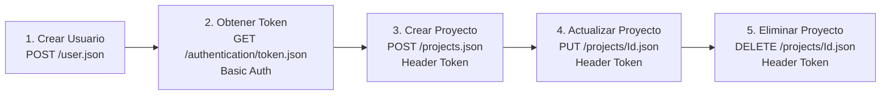

# 🚀 Todo.ly REST API Automation Framework

Framework profesional de automatización de pruebas para la API REST de **Todo.ly** ([Documentación oficial de Todo.ly](http://todo.ly/ApiWiki/)), implementado bajo principios de **Clean Code**, **Arquitectura Desacoplada**, **BDD (Behavior-Driven Development)** y **Java 17**.

---

## 🛠️ Stack Tecnológico

| Herramienta / Librería | Versión | Propósito |
| :--- | :--- | :--- |
| **Java** | `17 (LTS)` | Lenguaje de desarrollo base |
| **Gradle** | `8.x` | Gestor de construcción y dependencias |
| **RestAssured** | `5.4.0` | Cliente HTTP fluído para testing de APIs REST |
| **Cucumber Java** | `7.16.0` | Motor de BDD para escenarios en Gherkin (español) |
| **Cucumber TestNG** | `7.16.0` | Integración del runner de Cucumber con TestNG |
| **Cucumber PicoContainer** | `7.16.0` | Dependency Injection liviana para `TestContext` |
| **TestNG** | `7.10.2` | Runner de pruebas y aserciones |
| **Jackson Databind** | `2.17.0` | Serialización y deserialización JSON |

---

## 🏗️ Arquitectura y Principios de Diseño

El framework implementa una separación rigurosa de responsabilidades (SoC):

```text
Tarea 1 Automatizacion ll/
├── build.gradle                                            # Dependencias y configuración de ejecución de pruebas
├── settings.gradle                                         # Nombre del proyecto raíz
├── gradlew / gradlew.bat                                   # Gradle Wrapper para ejecución multiplataforma
├── README.md                                               # Documentación del proyecto
└── src/
    └── test/
        ├── java/
        │   ├── api/
        │   │   ├── ApiEndpoints.java                       # Base URL y constantes de endpoints
        │   │   ├── BaseApiClient.java                      # Configuración de RequestSpecification de RestAssured
        │   │   ├── UserClient.java                         # Operaciones sobre /user.json
        │   │   ├── AuthenticationClient.java               # Operaciones sobre /authentication/token.json
        │   │   └── ProjectClient.java                      # Operaciones CRUD sobre /projects.json
        │   ├── context/
        │   │   └── TestContext.java                        # Estado en tiempo de ejecución (Token, ProjectId, etc.)
        │   ├── runners/
        │   │   └── ApiTestRunner.java                      # Runner TestNG para ejecutar Cucumber
        │   ├── stepdefinitions/
        │   │   └── ProjectLifecycleSteps.java              # Steps de Gherkin (cero lógica HTTP directa)
        │   └── utils/
        │       └── DataGenerator.java                      # Generación de correos y datos dinámicos
        └── resources/
            └── features/
                └── project_lifecycle.feature               # Escenario E2E en lenguaje Gherkin
```

### Reglas Arquitectónicas Clave:
1. **Desacoplamiento Estricto de HTTP:** Las clases `StepDefinitions` **no contienen llamadas directas a RestAssured** (`given()`, `when()`, etc.). Toda interacción se encapsula en clientes dedicados (`UserClient`, `AuthenticationClient`, `ProjectClient`).
2. **Contexto de Prueba Aislado (`TestContext`):** Gestiona los datos en tiempo de ejecución (`TokenString`, `ProjectId`, `lastResponse`) mediante Dependency Injection con Cucumber PicoContainer, eliminando variables estáticas globales.
3. **Data Dinámica Anti-Colisión (`DataGenerator`):** Genera usuarios con emails únicos basados en timestamp (`qa_test_[timestamp]_[uuid]@testmail.com`), evitando fallos por cuentas duplicadas en Todo.ly.
4. **Validaciones Robustas:** Se validan códigos HTTP (200 OK), existencia y consistencia de identificadores numéricos, y valores de campos clave (`Content`, `Deleted: false` al crear y `Deleted: true` al eliminar).

---

## 🎯 Caso de Negocio Automatizado (Flujo E2E)

El escenario cubre el ciclo de vida completo de un proyecto en Todo.ly:



1. **Crear Usuario:** Envío de payload JSON con email único, password y nombre completo. Validación de código 200 y recepción de ID.
2. **Obtener Token:** Petición con HTTP Basic Auth. Extracción y almacenamiento del `TokenString`.
3. **Crear Proyecto:** Envío de POST con el header `Token: [TokenString]`. Almacenamiento del `Id` del proyecto creado.
4. **Actualizar Proyecto:** Envío de PUT con el nuevo nombre (`Content`). Validación del cambio en la respuesta.
5. **Eliminar Proyecto:** Envío de DELETE con el ID del proyecto. Validación de que `Deleted` es `true`.

---

## 🚀 Guía de Instalación y Ejecución

### 1. Requisitos Previos
- **Java JDK 17:** Verificar con `java -version`.
- **Git** (opcional, para clonar).

### 2. Generar el Gradle Wrapper (si se clona desde cero)
El proyecto ya incluye el wrapper configurado. Si necesitas regenerarlo en cualquier momento:
```bash
gradle wrapper
```

### 3. Ejecutar las Pruebas

#### En Windows (PowerShell / CMD):
```powershell
.\gradlew.bat clean test
```

#### En Linux / macOS:
```bash
chmod +x gradlew
./gradlew clean test
```

---

## 📊 Reportes de Ejecución

Una vez finalizadas las pruebas, se generan dos reportes interactivos:

1. **Reporte Cucumber HTML:**
   - Ubicación: `build/reports/cucumber/cucumber-report.html`
   - Muestra el paso a paso detallado del escenario Gherkin con estado de cada step.

2. **Reporte Estándar Gradle / TestNG:**
   - Ubicación: `build/reports/tests/test/index.html`
   - Muestra métricas de ejecución, tiempos y suites ejecutadas.
